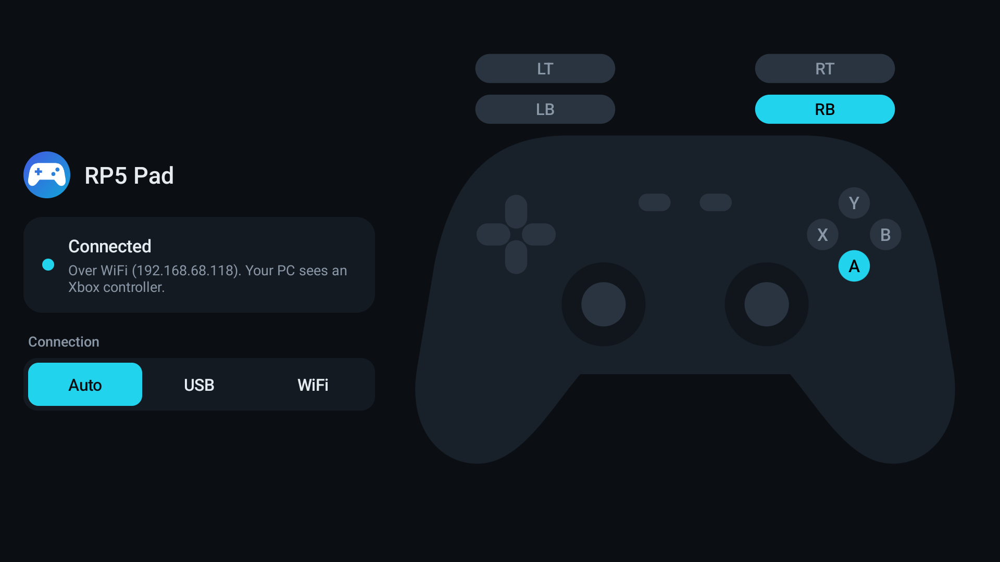
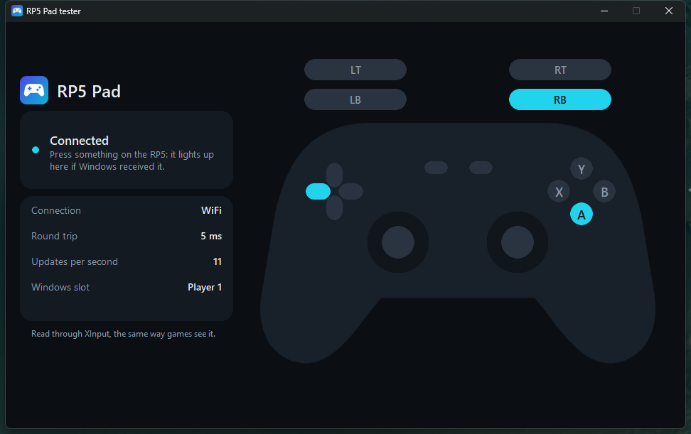

# RP5 Pad

Use a Retroid Pocket 5 (or another Android handheld with physical controls) as a wired or wireless Xbox 360 controller for a Windows PC. Windows and games see a normal XInput pad, which exists only while the device is connected.




## Install

**PC** (Windows 10/11, Python 3.13 tested): unzip `rp5pad-pc-*.zip`, then in that folder:

```
py -m venv .venv
.venv\Scripts\python -m pip install -r requirements.txt
.venv\Scripts\pythonw pad_tray.py
```

It needs the [ViGEmBus](https://github.com/nefarius/ViGEmBus/releases) driver (1.17 tested); installing `vgamepad` normally offers to install it. The app lives in the tray: left click opens the tester, right click has the settings, including Start with Windows.

**Device:** install `rp5pad-*.apk` and open it. It reads the controls only while it is in front with the screen on.

## Connecting

- **USB:** needs `adb` on the PATH and USB debugging on. The PC app sets up `adb reverse` by itself.
- **WiFi:** tick *Allow WiFi connections* in the tray menu. The app finds the PC by broadcast. The first connection asks you to compare a 6-digit code on both screens and press Yes on the PC.

## Limits

- No rumble.
- Over WiFi, input packets are authenticated at connect time but not encrypted, and the pairing key travels unencrypted during pairing. Pair on a network you trust.
- The APK is signed with a throwaway debug key.

## Building

`python build.py` builds `rp5pad.apk`. It needs Android SDK build-tools 36.1.0, platform 36 and a JDK; set `ANDROID_HOME` and `JAVA_HOME`. `make_assets.py` (needs Pillow) regenerates the logo and the tester pictures. The `test_*.py` scripts are manual checks; several drive a real device over adb and need paths adjusted.
